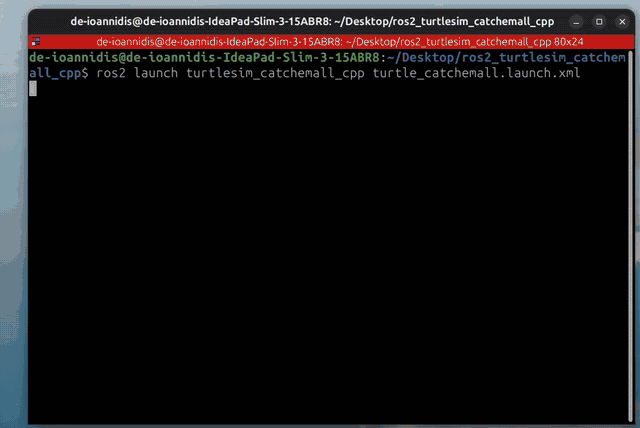
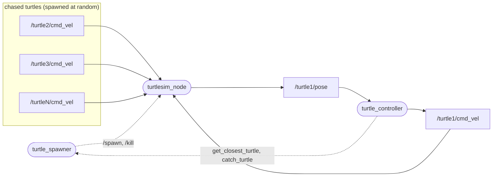
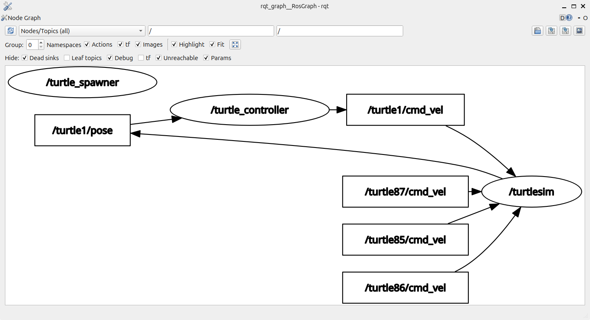

# ros2_turtlesim_catchemall_cpp

A small ROS 2 (Jazzy) project written in C++: a turtle chases and catches turtles that keep spawning at random positions in the [turtlesim](https://docs.ros.org/en/jazzy/Tutorials/Beginner-CLI-Tools/Introducing-Turtlesim/Introducing-Turtlesim.html) window.

This is my implementation of the capstone project for the [*ROS 2 for Beginners (ROS Jazzy)*](https://www.udemy.com/course/ros2-for-beginners/) course. It exercises nodes, topics, services, custom interfaces, parameters and launch files.



## How it works

Two nodes cooperate with the stock `turtlesim_node`:

| Node | Role |
|------|------|
| `turtle_spawner` | Spawns a turtle at a random pose on a timer (`/spawn`), tracks all alive turtles, and kills caught ones (`/kill`). Serves `get_closest_turtle` and `catch_turtle`. |
| `turtle_controller` | Drives `turtle1` (publishes `/turtle1/cmd_vel`, reads `/turtle1/pose`). Asks the spawner for the closest turtle, steers toward it with a PI heading controller, and requests the catch when within 0.2 units. |

The controller is a small state machine: `SEARCHING_FOR_TARGET` → `WAITING_FOR_TARGET_RESPONSE` → `CHASING_TARGET` → `WAITING_FOR_CATCH_RESPONSE` → back to searching. Each successful catch makes the turtle faster, up to a maximum speed.

### System overview

Solid arrows are topics, dashed arrows are service calls (pointing from client to server). The spawned "chased" turtles only get the per-turtle topics turtlesim creates for them; nothing publishes to those, so they stay still until caught.





*`rqt_graph` while running. Services (`get_closest_turtle`, `catch_turtle`, `/spawn`, `/kill`) are not shown, because rqt_graph only draws topics; see the diagram above.*

### Custom interfaces

- `msg/TurtleInfo.msg`: `name`, `x`, `y` of a spawned turtle
- `srv/GetClosestTurtle.srv`: request `x, y`, returns the closest `TurtleInfo` and `success`
- `srv/CatchTurtle.srv`: request a turtle `name`, returns `success`

### Parameters

Defaults are overridden in [`config/turtle_catchemall.yaml`](src/turtlesim_catchemall_cpp/config/turtle_catchemall.yaml).

| Node | Parameter | Meaning |
|------|-----------|---------|
| `turtle_spawner` | `spawn_timer_period_sec` | Seconds between spawns |
| `turtle_controller` | `heading_kp`, `heading_ki` | PI gains for heading tracking |
| | `my_turtle_init_velocity` / `my_turtle_max_velocity` | Starting and maximum linear speed |
| | `my_turtle_velocity_increment` | Speed gained per catch |
| | `my_turtle_min_velocity`, `my_turtle_distance_low_threshold` | Slow down when closer than the threshold, to avoid overshooting |
| | `my_turtle_ctrl_freq_hz` | Control loop rate |

## Build and run

Requires ROS 2 Jazzy and the `turtlesim` package (`sudo apt install ros-jazzy-turtlesim`).

```bash
git clone https://github.com/dimitr-io/ros2_turtlesim_catchemall_cpp.git
cd ros2_turtlesim_catchemall_cpp
source /opt/ros/jazzy/setup.bash
colcon build
source install/setup.bash
ros2 launch turtlesim_catchemall_cpp turtle_catchemall.launch.xml
```

The launch file starts `turtlesim_node`, `turtle_spawner` and `turtle_controller` together.

## License

MIT, see [LICENSE](LICENSE).
